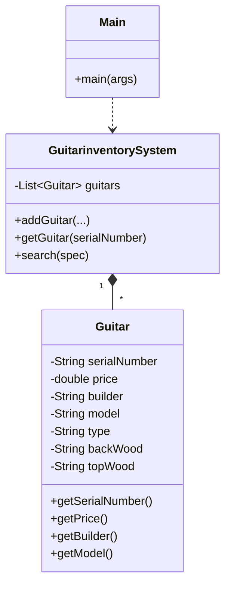

<p align="center">
  
</p>

<p align="center">
    
</p>


## 📌 Table of Contents
- [📖 Executive Summary](#-executive-summary)
- [✨ Key Features & Capabilities](#-key-features--capabilities)
- [🏗️ System Architecture & Workflow](#️-system-architecture--workflow)
- [🛠️ Tech Stack Breakdown](#️-tech-stack-breakdown)
- [⚙️ Reproducible Quickstart & Setup](#️-reproducible-quickstart--setup)
- [📂 Project Directory Layout](#-project-directory-layout)
- [👩‍💻 Author & Contributions](#-author--contributions)

---

## 📖 Executive Summary
### Problem Statement
Retail musical instrument businesses require flexible, decoupled inventory search mechanisms that shield instrument specifications while supporting dynamic attribute filtering.

### Motivation & Solution Overview
An Object-Oriented Java desktop application modeling musical instruments, inventory catalogs, and decoupled search algorithms using fundamental software engineering principles.

---

## ✨ Key Features & Capabilities
- **Strict Encapsulation:** Shields serial numbers, builder types, model names, wood specs, and pricing.
- **Decoupled Search Logic:** Search queries match client preferences without hardcoding instrument classes.
- **Architectural Documentation:** Includes structural object-level UML diagram (`object level diagram.jpg`).

---

## 🏗️ System Architecture & Workflow


---

## 🛠️ Tech Stack Breakdown
| Category | Technologies |
|---|---|
| **Language** | Java (JDK 8+) |
| **Design Paradigm** | Object-Oriented Programming (OOP) |
| **Modeling** | UML Object-Level Architectural Diagram |

---

## ⚙️ Reproducible Quickstart & Setup
### Compilation and Run
```bash
# 1. Clone repository
git clone https://github.com/Bhumikaravi/gis_java.git
cd gis_java

# 2. Compile Java source files
javac *.java

# 3. Execute Main entry point
java Main
```

---

## 📂 Project Directory Layout
```text
gis_java/
├── Guitar.java                  # Instrument entity class
├── GuitarinventorySystem.java   # Inventory catalog management & search engine
├── Main.java                    # Entry point & execution driver
├── object level diagram.jpg     # Object-level UML diagram
└── README.md
```

---

## 👩‍💻 Author & Contributions
Developed by **Bhumika Ravi** ([@Bhumikaravi](https://github.com/Bhumikaravi)), Bachelor of Computer Applications (BCA) at **Alliance University, Bengaluru**.

- 💻 **GitHub Profile:** [github.com/Bhumikaravi](https://github.com/Bhumikaravi)
- 🔗 **LinkedIn:** [linkedin.com/in/bhumika-ravi-b5a01b326](https://www.linkedin.com/in/bhumika-ravi-b5a01b326/)
- 📬 **Email Contact:** [bhumikaravi2006@gmail.com](mailto:bhumikaravi2006@gmail.com)

---

<p align="center">
  
</p>
